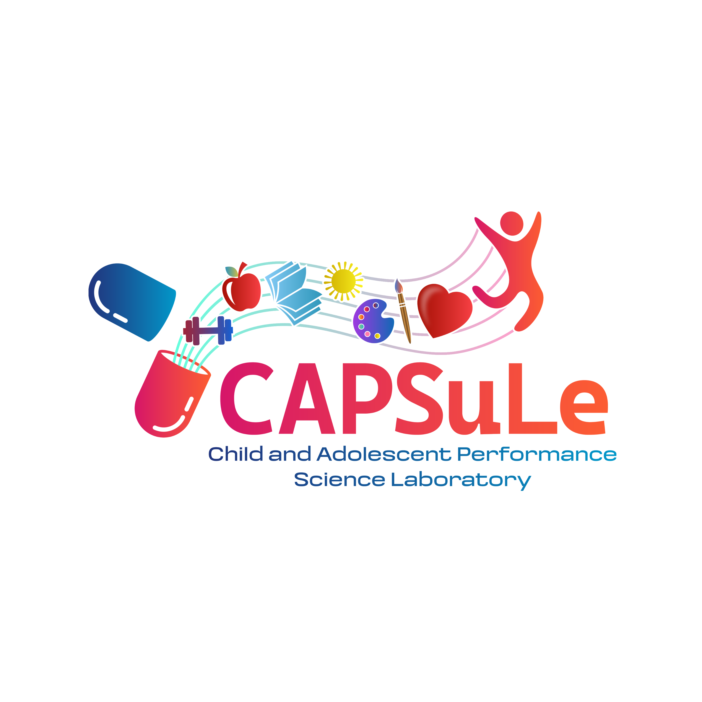

  

<h3 align="center">Child and Adolescent Performance Science Laboratory</h3>

  Equipping those who shape adolescent development with actionable insights grounded in science.

## What we do

We translate developmental research into material that parents, teachers, coaches, and clinicians can put to use:

* **Fieldwork:** a classroom curriculum that teaches resilience through the SEED Framework
* **Prescribed Dose:** a research blog where each post turns one finding into three things you can do today
* **Effective Dose:** a podcast of long-form interviews with the people doing the science
* **Extended Release:** live lectures that bring researchers into community spaces
* **Dinner & Development:** conversations about development, held around a meal
* **WordRx:** a documentary film about the hidden prescription behind healing

## Under the hood

[`thecapsl`](https://github.com/thecapsl/thecapsl) runs our public site, a members' library of weekly research editions, and a members-only community forum.

* Built with Django 6.1 and PostgreSQL, deployed on AWS
* Subscription billing through Stripe, with signed webhooks as the only source of access
* Every pull request is tested on Python 3.12–3.14 against a real database before it merges
* Locked pages contain only the public summary. Paid content never reaches someone who hasn't paid for it.

## Get involved

* [Explore our programs](https://thecapsl.org)
* [Support the lab](https://thecapsl.org): we're a 501(c)(3) nonprofit
* Follow along on [Instagram](https://www.instagram.com/the.capsl/), [LinkedIn](https://www.linkedin.com/company/the-capsl-), and [YouTube](https://www.youtube.com/@Effective-Dose)
* Email [contact@thecapsl.org](mailto:contact@thecapsl.org) to partner with us or fund our work

Visit [thecapsl.org](https://thecapsl.org) to learn more!

----

CAPSuLe is a 501(c)(3) nonprofit, founded in 2024. By educating adults, we change the path every young person walks.
